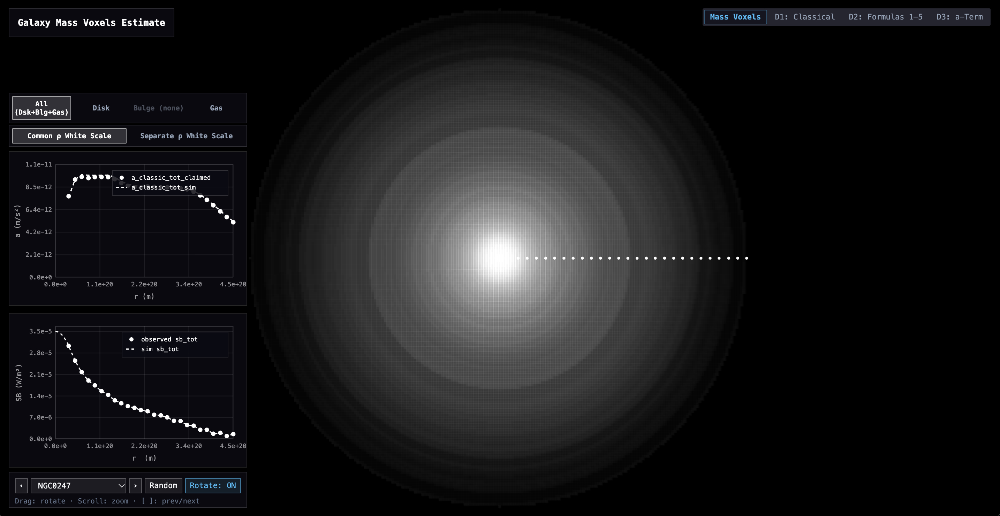
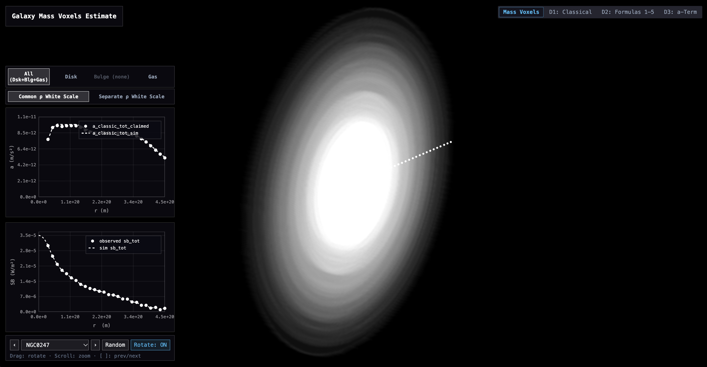
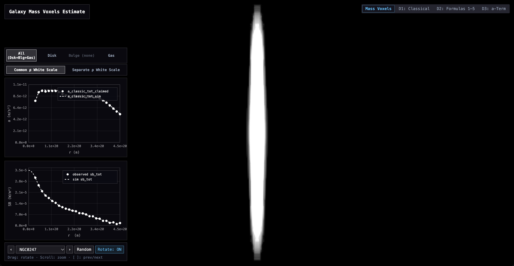

### Galactic-Scale Gravity
- Model a galaxy's 3D mass distribution
  - raw surface brightness --> mass pixels --> mass voxels
  - W/m^2 --> kg/m^2 --> kg/m^3
- Try various gravity formulas
- Compare a_pred to a_obs

---
### Use
- `index.html`
  - See 3D mass model of a galaxy (loads random galaxy on refresh)
  - Load a specific galaxy by /index.html?name=NGC5005
- `dashboard1.html`
  - Check quality of 3D mass model by comparing sim a_classic to SPARC-authors-claimed a_classic (from their reported v contribution, eq 1 https://arxiv.org/pdf/1803.00022)
- `dashboard2.html` `dashboard3.html`
  - Compare many a_gravformula to a_obs

---
### How were mass voxels calculated?
See code for details. Informally
- Disk
  - (r, surface brightness) --> mass pixels --> interpolation --> z height fx estimate --> mass voxels
- Bulge
  - (r, surface brightness) --> sphere model --> mass voxels
- Gas
  - (r, reported v contribution) --> (r, accel) --> nonnegativeleastsquares fit for radialsurfacedensity --> mass pixels --> z height fx estimate --> mass voxels

(Substantially aided by a GPT (Gemini 4))

---
### Data

SPARC: Mass Models for 175 Disk Galaxies with Spitzer Photometry and Accurate Rotation Curves
https://astroweb.case.edu/SPARC (Table2.mrt)

---
### Gravity Formulas
1) Classic: a = GM/r^2
2) MOND (Milgrom): a = GM/r^2 / (1 - e^(-sqrt((GM/r^2) / (c^2/87Gly))))
3) Conformal (Mannheim): a = GM/r^2 + k1 M + k2 + k3 r_galaxycenter, with k1 ≈ 1.2e-52 m/(s^2 kg), k2 ≈ 1.4e-11 m/s^2, k3 ≈ -8.6e-33 1/s^2
4) Polynomial: a = GM/r^2 + k1 GM/r + k2 GM + k3 GMr + k4 GMr^2, with k1 ≈ 5.4e-21 1/m, k2 ≈ -5.8e-42 1/m^2, k3 ≈ 3.1e-63 1/m^3, k4 ≈ -5.0e-85 1/m^4
5) Accel-dep term: a = GM/r^2 (1 + (c^2/87Gly) / a), and solve w quadratic formula
